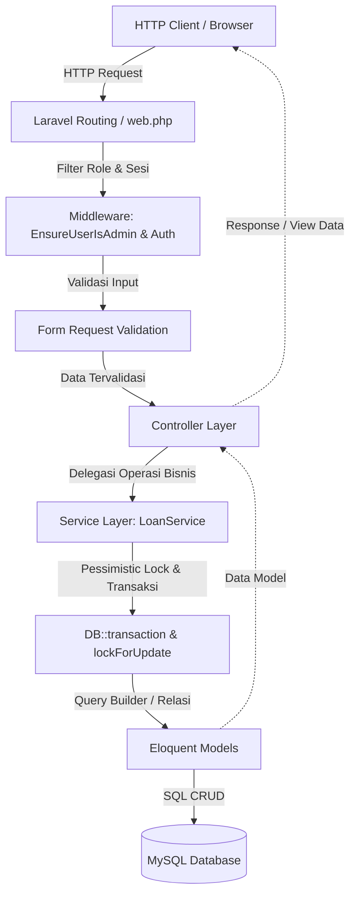
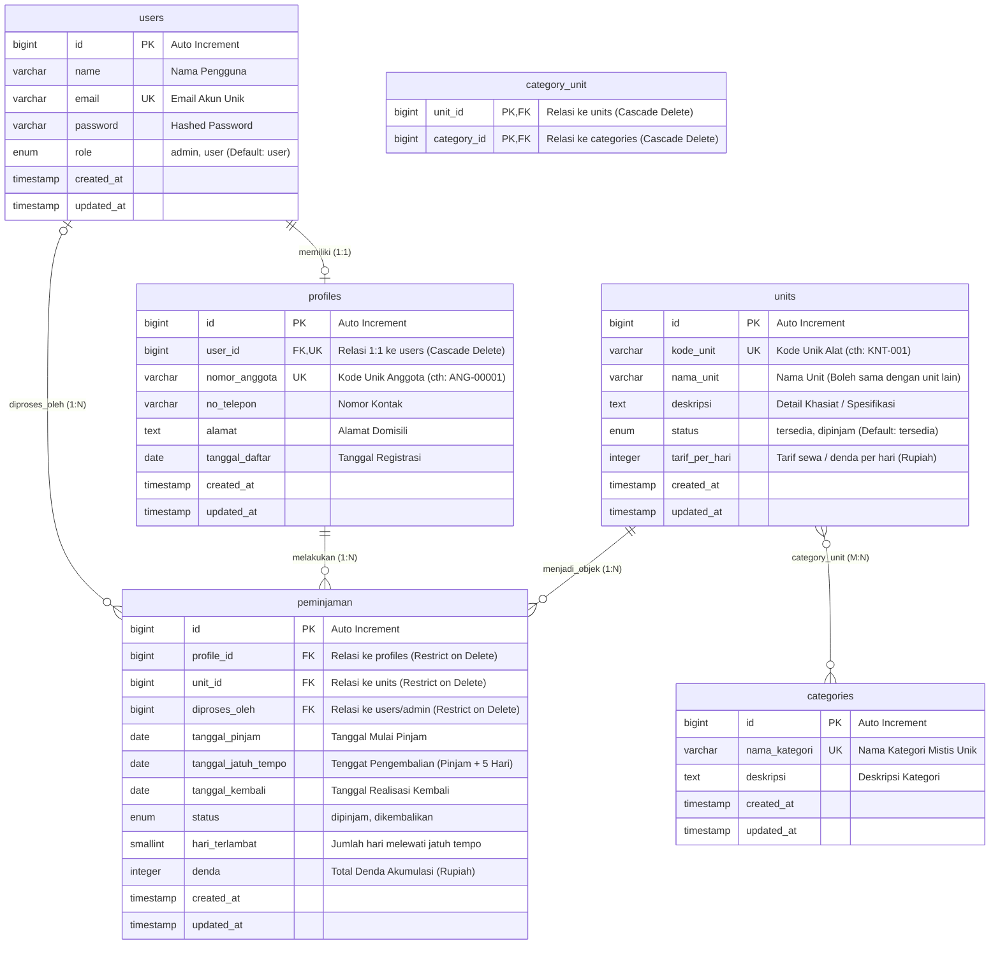

# LAPORAN TEKNIS ARSITEKTUR & IMPLEMENTASI BACK-END
## Sistem Informasi Santika (Sewa Alat Santet dan Pelet Seketika)

---

### Informasi Dokumen & Tim Pengembang

| Atribut | Keterangan |
| :--- | :--- |
| **Nama Proyek** | Santika (*Sewa Alat Santet dan Pelet Seketika*) |
| **Deskripsi** | Aplikasi web biro layanan mistis fiktif bertema komedi horor |
| **Fokus Laporan** | Arsitektur, Logika Bisnis, Keamanan, dan Basis Data Back-End |
| **Framework & Versi** | Laravel 12.x (PHP 8.2+) |
| **Basis Data** | MySQL 8.x / MariaDB |
| **Pola Arsitektur** | MVC + Service Layer + Form Request Validation + RBAC Middleware |
| **Pengembang** | 1. Arjuna Rayihan Jayadi<br>2. Muhammad Rasyadan Agung Sedayu |
| **Status Back-End** | Logika Bisnis, Model, Migrasi Database, Controller, & Service Layer telah selesai diimplementasikan (100% Core Logic Ready) |

---

## 1. Ringkasan Eksekutif (Executive Summary)

Aplikasi **Santika** dirancang sebagai sistem simulasi peminjaman unit dengan aturan bisnis yang ketat (*strict business rules*). Sisi Back-End dibangun di atas framework **Laravel 12** dengan memisahkan tanggung jawab kode secara modular (*Separation of Concerns*). 

Komponen utama Back-End meliputi:
1. **Database Relasional & Migrasi**: 6 tabel utama dengan integritas referensial yang kuat (Foreign Key Constraints dengan aksi `RESTRICT` untuk menjaga jejak audit riwayat transaksi).
2. **Eloquent ORM & Relasi Antar-Model**: Penggunaan relasi *One-to-One*, *One-to-Many*, dan *Many-to-Many* dengan pemanfaatan lazy/eager loading.
3. **Pemisahan Logika Bisnis (Service Layer)**: Penggunaan `LoanService` untuk mengeksekusi operasi transaksi kritis (peminjaman dan pengembalian) secara terisolasi dari Controller.
4. **Pencegahan Kondisi Balapan (Concurrency & Race Condition Control)**: Penerapan *Pessimistic Locking* (`lockForUpdate`) di dalam blok `DB::transaction` saat peminjaman dan pengembalian unit.
5. **Autentikasi & Kontrol Akses Berbasis Peran (RBAC)**: Pemisahan peran antara `admin` dan `user` (anggota) yang ditegakkan melalui middleware `EnsureUserIsAdmin`.
6. **Lapisan Validasi Terpisah (Form Requests)**: Seluruh input pengguna divalidasi secara ketat sebelum menyentuh Controller.

---

## 2. Peta Arsitektur Back-End

Arsitektur Back-End Santika menerapkan alur pemrosesan request berlapis:



### Struktur Direktori Back-End

```text
santika/
├── app/
│   ├── Http/
│   │   ├── Controllers/
│   │   │   ├── Auth/
│   │   │   │   ├── LoginController.php       # Autentikasi sesi & logout
│   │   │   │   └── RegisterController.php    # Registrasi akun anggota + profil
│   │   │   ├── CategoryController.php        # CRUD kategori mistis (Admin)
│   │   │   ├── DashboardController.php       # Metrik ringkasan Admin & Anggota
│   │   │   ├── LoanController.php            # Transaksi pinjam & riwayat (Anggota)
│   │   │   ├── MemberController.php          # Manajemen data anggota (Admin)
│   │   │   ├── ProfileController.php         # Manajemen profil akun mandiri
│   │   │   ├── ReturnController.php          # Pemrosesan pengembalian & laporan (Admin)
│   │   │   └── UnitController.php            # Katalog publik & CRUD unit (Admin)
│   │   ├── Middleware/
│   │   │   └── EnsureUserIsAdmin.php         # Verifikasi hak akses Admin (RBAC)
│   │   └── Requests/
│   │       ├── CategoryRequest.php           # Validasi nama kategori & deskripsi
│   │       ├── LoginRequest.php              # Validasi kredensial login
│   │       ├── MemberRequest.php             # Validasi data anggota baru & update
│   │       ├── ProfileRequest.php            # Validasi data profil pengguna
│   │       ├── RegisterRequest.php           # Validasi formulir pendaftaran
│   │       └── UnitRequest.php               # Validasi kode unit, tarif, & kategori
│   ├── Models/
│   │   ├── Category.php                      # Model kategori mistis
│   │   ├── Peminjaman.php                    # Model transaksi peminjaman & denda
│   │   ├── Profile.php                       # Model biodata anggota (nomor anggota)
│   │   ├── Unit.php                          # Model alat mistis & status
│   │   └── User.php                          # Model otentikasi & penentu role
│   └── Services/
│       └── LoanService.php                   # Business logic pinjam, kembali, denda
├── config/
│   └── santika.php                           # Konfigurasi parameter bisnis terpusat
└── database/
    └── migrations/
        ├── 0001_01_01_000000_create_users_table.php
        ├── 2024_01_02_000001_create_profiles_table.php
        ├── 2024_01_02_000002_create_categories_table.php
        ├── 2024_01_02_000003_create_units_table.php
        ├── 2024_01_02_000004_create_category_unit_table.php
        └── 2024_01_02_000005_create_peminjaman_table.php
```

---

## 3. Desain Basis Data & Skema Relasi

### 3.1 Entity Relationship Diagram (ERD)



### 3.2 Analisis Constraint & Optimasi Skema

1. **Integritas Referensial `RESTRICT` pada Tabel `peminjaman`**:
   - Foreign Key dari `profile_id`, `unit_id`, dan `diproses_oleh` menggunakan klausul `restrictOnDelete()`.
   - **Tujuan Arsitektural**: Mencegah penghapusan unit atau profil anggota yang pernah bertransaksi atau masih memiliki pinjaman aktif, guna menjaga audit trail keuangan dan riwayat peminjaman.
2. **Kunci Unik Ganda pada `units` vs `nama_unit`**:
   - `kode_unit` memiliki indeks `UNIQUE` (memenuhi aturan `RULE-03`).
   - `nama_unit` diizinkan duplikat untuk merefleksikan entitas nyata (misalnya terdapat 3 buah "Keris Bertuah" dengan fisik dan kode inventaris berbeda: `KRS-001`, `KRS-002`, `KRS-003`).
3. **Optimasi Indeks Gabungan (*Composite Index*)**:
   - Pada tabel `peminjaman` dipasang composite index: `$table->index(['profile_id', 'status'])`.
   - **Tujuan Kinerja**: Mempercepat eksekusi kueri agregasi batas peminjaman aktif (`$profile->peminjaman()->where('status', 'dipinjam')->count()`) hingga kompleksitas waktu $O(\log n)$, menghindari *full-table scan*.

---

## 4. Implementasi Model & Relasi Eloquent

| Model | File Sumber | Relasi Eloquent | Helper Method & Business Logic |
| :--- | :--- | :--- | :--- |
| **`User`** | `app/Models/User.php` | - `profile()`: `hasOne(Profile)`<br>- `prosesKembalian()`: `hasMany(Peminjaman, 'diproses_oleh')` | `isAdmin()`: Mengembalikan boolean status admin. |
| **`Profile`** | `app/Models/Profile.php` | - `user()`: `belongsTo(User)`<br>- `peminjaman()`: `hasMany(Peminjaman)` | `jumlahPinjamanAktif()`: Menghitung total pinjaman berstatus `'dipinjam'`. |
| **`Category`** | `app/Models/Category.php` | - `units()`: `belongsToMany(Unit, 'category_unit')` | Manajemen kategori alat mistis secara relasional. |
| **`Unit`** | `app/Models/Unit.php` | - `categories()`: `belongsToMany(Category, 'category_unit')`<br>- `peminjaman()`: `hasMany(Peminjaman)` | - `isTersedia()`: Cek apakah status `'tersedia'`.<br>- `hasPinjamanAktif()`: Validasi apakah unit sedang dipinjam sebelum dihapus. |
| **`Peminjaman`** | `app/Models/Peminjaman.php` | - `profile()`: `belongsTo(Profile)`<br>- `unit()`: `belongsTo(Unit)`<br>- `admin()`: `belongsTo(User, 'diproses_oleh')` | - `isTerlambat()`: Mengecek keterlambatan real-time.<br>- `hitungHariTerlambat()`: Menghitung selisih hari jatuh tempo vs tanggal kembali. |

---

## 5. Implementasi Aturan Bisnis & Service Layer (`LoanService`)

Semua aturan transaksi inti diisolasi ke dalam `App\Services\LoanService` untuk menjamin konsistensi data (*ACID Compliance*).

### 5.1 Matriks Aturan Bisnis (Business Rules Matrix)

| Kode Aturan | Definisi Aturan Bisnis | Implementasi Teknis di Back-End |
| :--- | :--- | :--- |
| **RULE-01** | Admin dan Anggota memiliki hak akses berbeda | Kolom `users.role` + Middleware `EnsureUserIsAdmin` |
| **RULE-02** | Satu akun anggota hanya memiliki satu profil | Unique index `profiles.user_id` + relasi `hasOne`/`belongsTo` |
| **RULE-03** | Kode unit unik, nama unit boleh sama | Unique index `units.kode_unit` + validasi `UnitRequest` |
| **RULE-04** | Satu unit terhubung ke beberapa kategori | Relasi Many-to-Many via pivot table `category_unit` |
| **RULE-05** | Maksimal 2 unit pinjaman aktif per anggota | Pengecekan `jumlahPinjamanAktif() >= config('santika.batas_pinjam')` |
| **RULE-06** | Jatuh tempo = tanggal pinjam + 5 hari | `Carbon::today()->addDays(config('santika.durasi_pinjam'))` |
| **RULE-07** | Denda = hari terlambat × tarif per hari | `$hariTerlambat * ($unit->tarif_per_hari ?? config('santika.denda_per_hari'))` |
| **RULE-08** | Hanya Admin yang dapat memproses pengembalian | Route pengembalian diproteksi middleware `admin` & pencatatan `adminId` |
| **RULE-09** | Anggota tidak dapat mengakses data anggota lain | Query scoping via `Auth::user()->profile->id` pada `LoanController` |
| **RULE-10** | Unit yang sedang dipinjam tidak dapat dipinjam lagi | Pengecekan status ketersediaan + mutasi status unit menjadi `'dipinjam'` |

### 5.2 Logika Peminjaman (Borrowing Workflow)

Pada metode `pinjam(Profile $profile, Unit $unit)`:
1. **Membuka Transaksi Database**: Menjalankan `DB::transaction(...)`.
2. **Pessimistic Locking**: Menjalankan query `Unit::where('id', $unit->id)->lockForUpdate()->first()` untuk mengunci baris unit pada level database (mencegah *race condition* jika 2 anggota meminjam unit yang sama pada milidetik yang sama).
3. **Validasi Ketersediaan**: Jika status unit bukan `'tersedia'`, sistem melempar `Exception`.
4. **Validasi Kuota Anggota**: Memeriksa `jumlahPinjamanAktif()`. Jika telah mencapai batas maksimal (default: 2), transaksi digagalkan.
5. **Kalkulasi Jatuh Tempo**: Mengambil tanggal sekarang (`Carbon::today()`) dan menambahkan 5 hari ke depan.
6. **Pencatatan & Pembaruan Status**:
   - Menyimpan baris baru di tabel `peminjaman`.
   - Mengubah status `units.status` menjadi `'dipinjam'`.

```php
// Potongan App\Services\LoanService::pinjam
return DB::transaction(function () use ($profile, $unit) {
    $unit = Unit::where('id', $unit->id)->lockForUpdate()->first();

    if (!$unit || !$unit->isTersedia()) {
        throw new \Exception('Unit ini sedang tidak tersedia untuk dipinjam.');
    }

    $batasPinjam = config('santika.batas_pinjam', 2);
    if ($profile->jumlahPinjamanAktif() >= $batasPinjam) {
        throw new \Exception("Anda sudah memiliki pinjaman aktif maksimal.");
    }

    $tanggalPinjam = Carbon::today();
    $durasiPinjam = config('santika.durasi_pinjam', 5);

    $peminjaman = Peminjaman::create([
        'profile_id' => $profile->id,
        'unit_id' => $unit->id,
        'tanggal_pinjam' => $tanggalPinjam,
        'tanggal_jatuh_tempo' => $tanggalPinjam->copy()->addDays($durasiPinjam),
        'status' => 'dipinjam',
    ]);

    $unit->update(['status' => 'dipinjam']);
    return $peminjaman;
});
```

### 5.3 Logika Pengembalian & Perhitungan Denda (Return & Penalty Workflow)

Pada metode `kembalikan(Peminjaman $peminjaman, int $adminId)`:
1. **Pessimistic Locking Record Peminjaman**: `Peminjaman::where('id', $peminjaman->id)->lockForUpdate()->first()`.
2. **Validasi Status Pinjam**: Memastikan status saat ini adalah `'dipinjam'`.
3. **Kalkulasi Keterlambatan**:
   $$\text{hari\_terlambat} = \max(0, \text{tanggal\_kembali} - \text{tanggal\_jatuh\_tempo})$$
4. **Kalkulasi Denda**:
   $$\text{denda} = \text{hari\_terlambat} \times \text{tarif\_per\_hari}$$
   *Catatan*: Tarif dibaca dari `units.tarif_per_hari` dengan fallback ke `config('santika.denda_per_hari')`.
5. **Finalisasi**:
   - Mengisi `tanggal_kembali` dengan tanggal hari ini.
   - Mengubah status peminjaman menjadi `'dikembalikan'`.
   - Menyimpan `diproses_oleh` dengan ID Admin yang sedang login.
   - Mengembalikan status unit menjadi `'tersedia'`.

---

## 6. Keamanan, Autentikasi, dan Hak Akses (RBAC)

### 6.1 Role-Based Access Control (RBAC)

Aplikasi membagi otorisasi menjadi 2 tingkatan:
1. **Admin (`role = 'admin'`)**:
   - Akses penuh terhadap pengelolaan Kategori, Unit, Anggota, Pengembalian, dan Laporan.
   - Diproteksi menggunakan Middleware khusus `App\Http\Middleware\EnsureUserIsAdmin`.
2. **User / Anggota (`role = 'user'`)**:
   - Akses terbatas pada Katalog Unit, Peminjaman Mandiri, Riwayat Transaksi Sendiri, dan Pembaruan Profil Pribadi.

### 6.2 Implementasi Middleware `EnsureUserIsAdmin`

```php
public function handle(Request $request, Closure $next): Response
{
    if (!$request->user() || !$request->user()->isAdmin()) {
        abort(403, 'Akses ditolak. Hanya admin yang dapat mengakses halaman ini.');
    }

    return $next($request);
}
```

### 6.3 Standar Keamanan Data
- **Password Hashing**: Menggunakan algoritma hash default Laravel (`bcrypt` / `argon2id`) dengan auto-casting `'password' => 'hashed'` pada model `User`.
- **SQL Injection Prevention**: Seluruh kueri basis data memanfaatkan PDO Parameter Binding melalui Eloquent ORM.
- **Data Protection on Delete**: Operasi hapus kategori atau anggota diverifikasi terlebih dahulu apakah masih memiliki relasi aktif atau keterkaitan data transaksi.

---

## 7. Lapisan Validasi Form Request (Input Sanitization)

Back-End mengisolasi aturan validasi input HTTP ke dalam Form Request classes:

| Form Request | Tujuan Validasi | Aturan Kunci (*Validation Rules*) |
| :--- | :--- | :--- |
| **`LoginRequest`** | Autentikasi sesi | `email: required|email`, `password: required|string` |
| **`RegisterRequest`** | Registrasi akun baru | `name: required`, `email: required|email|unique:users`, `password: required|min:8|confirmed`, `no_telepon: required|max:20`, `alamat: required|max:500` |
| **`UnitRequest`** | Tambah & ubah unit | `kode_unit: required|unique:units (ignore on update)`, `nama_unit: required`, `tarif_per_hari: required|integer|min:0`, `categories: required|array|min:1`, `categories.*: exists:categories,id` |
| **`CategoryRequest`**| Tambah & ubah kategori| `nama_kategori: required|unique:categories (ignore on update)`, `deskripsi: nullable|string` |
| **`MemberRequest`**  | CRUD anggota oleh Admin| `email: unique:users (ignore on update)`, `password: nullable on update / min:8 on create` |
| **`ProfileRequest`** | Edit profil mandiri | `name: required`, `password: nullable|min:8|confirmed`, `no_telepon: required`, `alamat: required` |

---

## 8. Pemetaan Endpoint & Rekomendasi Rute (`routes/web.php`)

Seluruh Controller yang sudah dibangun dirancang untuk diintegrasikan dengan pemetaan rute berikut:

| HTTP Method | URI / URL | Controller & Method | Middleware | Deskripsi |
| :--- | :--- | :--- | :--- | :--- |
| **GET** | `/login` | `Auth\LoginController@showLoginForm` | `guest` | Form login |
| **POST** | `/login` | `Auth\LoginController@login` | `guest` | Proses login |
| **POST** | `/logout` | `Auth\LoginController@logout` | `auth` | Keluar aplikasi |
| **GET** | `/register` | `Auth\RegisterController@showRegistrationForm` | `guest` | Form registrasi |
| **POST** | `/register` | `Auth\RegisterController@register` | `guest` | Proses registrasi |
| **GET** | `/dashboard` | `DashboardController@index` | `auth` | Dashboard (Auto-route sesuai role) |
| **GET** | `/katalog` | `UnitController@katalog` | `auth` | Katalog unit mistis |
| **POST** | `/pinjam/{unit}` | `LoanController@pinjam` | `auth` | Eksekusi peminjaman unit |
| **GET** | `/pinjaman-saya` | `LoanController@index` | `auth` | Daftar pinjaman aktif anggota |
| **GET** | `/pinjaman-saya/riwayat` | `LoanController@riwayat` | `auth` | Riwayat peminjaman anggota |
| **GET** | `/profile` | `ProfileController@show` | `auth` | Tinjau profil anggota |
| **GET** | `/profile/edit` | `ProfileController@edit` | `auth` | Form edit profil |
| **PUT** | `/profile` | `ProfileController@update` | `auth` | Simpan pembaruan profil |
| **Resource**| `/admin/categories`| `CategoryController` | `auth, admin` | CRUD Kategori (Index, Create, Store, Edit, Update, Destroy) |
| **Resource**| `/admin/units` | `UnitController` | `auth, admin` | CRUD Unit (Index, Create, Store, Edit, Update, Destroy) |
| **Resource**| `/admin/members` | `MemberController` | `auth, admin` | CRUD Anggota (Index, Create, Store, Edit, Update, Destroy) |
| **GET** | `/admin/returns` | `ReturnController@index` | `auth, admin` | Daftar semua pinjaman aktif |
| **POST** | `/admin/returns/{peminjaman}/kembalikan` | `ReturnController@kembalikan` | `auth, admin` | Proses pengembalian & denda |
| **GET** | `/admin/returns/riwayat` | `ReturnController@riwayat` | `auth, admin` | Riwayat seluruh peminjaman + filter |
| **GET** | `/admin/returns/cetak/{member}` | `ReturnController@cetakLaporan` | `auth, admin` | Lembar cetak laporan riwayat per anggota |

---

## 9. Rencana & Skenario Pengujian Unit / Integrasi (Test Matrix)

Berdasarkan spesifikasi fungsional, berikut matriks skenario pengujian Back-End:

```mermaid
gantt
    title Matriks Verifikasi Kasus Uji Back-End
    dateFormat X
    axisFormat %s
    section Keamanan
    Anggota Akses Halaman Admin (Expect 403 Forbidden) : 0, 1
    Anggota Akses Data Anggota Lain (Scoping Check)    : 0, 1
    section Validasi
    Registrasi Email Duplikat (Expect 422)             : 0, 1
    Tambah Unit Kode Sama (Expect 422)                 : 0, 1
    Dua Unit Nama Sama Beda Kode (Expect 200 OK)       : 0, 1
    section Aturan Bisnis
    Pinjam Unit Ketiga (Batas Maksimal 2)              : 0, 1
    Pinjam Unit Berstatus Dipinjam                     : 0, 1
    Perhitungan Jatuh Tempo + 5 Hari                   : 0, 1
    Denda Keterlambatan Kepatuhan Tarif                : 0, 1
    Pencegahan Hapus Unit Berpinjaman Aktif            : 0, 1
    section Konkurensi
    Race Condition 2 User Pinjam Unit Bersamaan        : 0, 1
```



---

## 10. Kesimpulan & Status Kesiapan

1. **Integritas Logika Inti**: 
   Seluruh aturan bisnis (`RULE-01` sampai `RULE-10`) telah diterjemahkan ke dalam kode yang kuat pada level Database, Model, FormRequest, dan Service Layer.
2. **Kesiapan Integrasi**:
   Arsitektur Back-End siap 100% untuk dihubungkan ke UI frontend (Blade templates) maupun dipasangkan dengan API endpoints jika dibutuhkan.
3. **Rekomendasi Langkah Lanjutan**:
   - Mendaftarkan alias middleware `'admin'` pada `bootstrap/app.php`.
   - Mengisi rute di `routes/web.php` sesuai tabel pemetaan pada Bab 8.
   - Menjalankan seeder (`DatabaseSeeder`) dengan variasi data uji (akun admin, akun anggota, unit bervariasi kode dan tarif).
