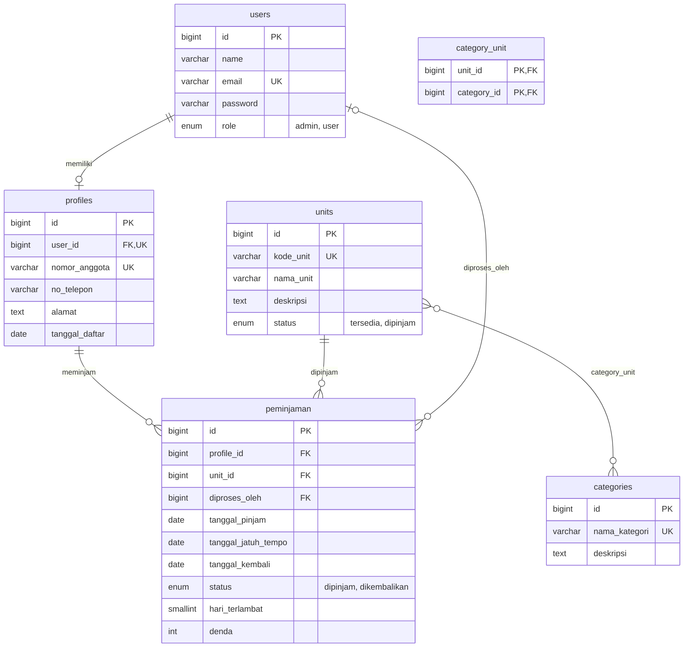

# Santika

**Urusan Mistis, Tinggal Klik**

Santika (Sewa Alat Santet dan Pelet Seketika) adalah aplikasi web simulasi biro layanan mistis fiktif bertema komedi horor. Anggota dapat melihat katalog unit mistis, mencari unit berdasarkan nama, dan meminjamnya. Admin mengelola kategori, unit, anggota, pengembalian, dan laporan.

> **Disclaimer:** seluruh layanan dan unit bertema mistis di aplikasi ini bersifat **fiktif** dan hanya digunakan untuk simulasi pembelajaran. Tidak ada integrasi dengan layanan supernatural nyata atau tindakan yang bertujuan mencelakai orang.

---

## Informasi Tim

| | |
| --- | --- |
| **Nama project** | Santika |
| **Nama kelompok** | [isi nama kelompok] |
| **Anggota** | Arjuna Rayihan Jayadi |
| | Muhammad Rasyadan Agung Sedayu |

---

## Daftar Isi

- [Tech Stack](#tech-stack)
- [Daftar Fitur](#daftar-fitur)
- [Aturan Bisnis](#aturan-bisnis)
- [Skema Database](#skema-database)
- [Instalasi dan Menjalankan Aplikasi](#instalasi-dan-menjalankan-aplikasi)
- [Akun Seeder](#akun-seeder)
- [Struktur Proyek](#struktur-proyek)
- [Pengujian](#pengujian)
- [Dokumentasi Proyek](#dokumentasi-proyek)
- [Demo dan Screenshot](#demo-dan-screenshot)

---

## Tech Stack

- **Framework:** Laravel
- **Bahasa:** PHP 8.2 atau lebih baru
- **Database:** MySQL
- **Frontend:** Blade + CSS/JS (sesuaikan dengan yang dipakai, misalnya Tailwind atau Bootstrap)
- **Dependency:** Composer, Node.js dan npm
- **Target browser:** browser desktop modern

---

## Daftar Fitur

### Semua pengguna

- Registrasi mandiri (menghasilkan satu akun beserta satu profil), login, dan logout.
- Seluruh halaman selain login dan registrasi dilindungi autentikasi.

### Anggota

- Melihat dan memperbarui **profil sendiri**.
- Melihat katalog unit beserta kategori dan status ketersediaan.
- **Mencari unit** berdasarkan nama.
- **Meminjam unit** dengan validasi batas jumlah, ketersediaan, dan durasi.
- Melihat pinjaman aktif dan **riwayat peminjaman sendiri**, termasuk penanda terlambat.

### Admin

- **CRUD kategori**, **unit** (satu unit dapat memiliki banyak kategori), dan **anggota**.
- Melihat semua pinjaman aktif.
- **Memproses pengembalian**; denda keterlambatan dihitung otomatis.
- Melihat riwayat peminjaman seluruh anggota dengan filter.
- **Mencetak laporan** riwayat per anggota.

### Sistem

- Validasi input di sisi server.
- Transaksi database dan penguncian baris unit untuk mencegah dua anggota meminjam unit yang sama secara bersamaan.
- Migration dan seeder untuk data awal.

---

## Aturan Bisnis

| Kode | Aturan |
| --- | --- |
| RULE-01 | Admin dan Anggota memiliki hak akses berbeda. |
| RULE-02 | Satu akun anggota hanya memiliki satu profil. |
| RULE-03 | Kode unit wajib diisi dan unik; nama unit boleh sama. |
| RULE-04 | Satu unit dapat terhubung ke beberapa kategori. |
| RULE-05 | Maksimal **2 unit** yang sedang dipinjam per anggota. |
| RULE-06 | Jatuh tempo = tanggal pinjam + **5 hari**. |
| RULE-07 | Denda = hari terlambat × tarif harian per unit. |
| RULE-08 | Hanya Admin yang dapat memproses pengembalian. |
| RULE-09 | Anggota tidak dapat mengakses profil atau riwayat anggota lain. |
| RULE-10 | Unit yang sedang dipinjam tidak dapat dipinjam anggota lain. |

**Perhitungan denda**

```
tanggal_jatuh_tempo = tanggal_pinjam + 5 hari
hari_terlambat      = max(0, tanggal_kembali - tanggal_jatuh_tempo)
denda               = hari_terlambat x tarif_per_hari
```

Tarif default: **Rp10.000 per unit per hari** (asumsi awal untuk simulasi, dapat diubah lewat konfigurasi). Contoh: terlambat 2 hari = Rp20.000 per unit.

---

## Skema Database

Enam tabel inti: `users`, `profiles`, `categories`, `units`, `category_unit`, dan `peminjaman`.



Constraint penting:

- `units.kode_unit` UNIQUE, jadi dua unit tidak bisa berkode sama walau namanya sama.
- `profiles.user_id` UNIQUE, jadi satu user hanya punya satu profil.
- Indeks gabungan `peminjaman (profile_id, status)` untuk pengecekan batas 2 unit aktif.
- FK dari `peminjaman` memakai `RESTRICT` agar data berriwayat tidak terhapus diam-diam.

> Screenshot skema database: letakkan di `docs/erd.png` lalu tampilkan di bagian [Demo dan Screenshot](#demo-dan-screenshot).

---

## Instalasi dan Menjalankan Aplikasi

### Prasyarat

- PHP 8.2+ dengan ekstensi umum Laravel (`mbstring`, `xml`, `curl`, `pdo_mysql`, `openssl`, `tokenizer`, `ctype`, `fileinfo`)
- Composer
- Node.js dan npm
- MySQL 8+ (atau MariaDB yang kompatibel)
- Git

### Langkah-langkah

1. **Clone repository**

   ```bash
   git clone <url-repository-gitlab> santika
   cd santika
   ```

2. **Install dependency**

   ```bash
   composer install
   npm install
   ```

3. **Salin file environment dan buat app key**

   ```bash
   cp .env.example .env
   php artisan key:generate
   ```

4. **Buat database MySQL**

   ```sql
   CREATE DATABASE santika CHARACTER SET utf8mb4 COLLATE utf8mb4_unicode_ci;
   ```

5. **Atur koneksi database di `.env`**

   ```env
   APP_NAME=Santika
   APP_URL=http://localhost:8000

   DB_CONNECTION=mysql
   DB_HOST=127.0.0.1
   DB_PORT=3306
   DB_DATABASE=santika
   DB_USERNAME=root
   DB_PASSWORD=

   # Tarif denda per unit per hari (rupiah)
   DENDA_PER_HARI=10000
   ```

   > Nama variabel `DENDA_PER_HARI` mengikuti konvensi tim; pastikan dibaca lewat `config/` (misalnya `config/santika.php`) dan tidak dipanggil langsung dengan `env()` di luar file config.

6. **Jalankan migration dan seeder**

   ```bash
   php artisan migrate --seed
   ```

   Untuk mengulang dari awal:

   ```bash
   php artisan migrate:fresh --seed
   ```

7. **Build aset frontend**

   ```bash
   npm run build
   ```

   Atau mode pengembangan:

   ```bash
   npm run dev
   ```

8. **Jalankan server**

   ```bash
   php artisan serve
   ```

   Buka <http://localhost:8000>.

### Urutan migration

`users` → `profiles` → `categories` → `units` → `category_unit` → `peminjaman`

Tabel yang direferensikan harus dibuat lebih dulu agar foreign key valid.

---

## Akun Seeder

Seeder membuat satu akun Admin, beberapa anggota contoh beserta profilnya, beberapa kategori gaib, dan daftar unit (termasuk contoh unit bernama sama dengan kode berbeda).

| Role | Email | Password |
| --- | --- | --- |
| Admin | [isi sesuai seeder] | [isi sesuai seeder] |
| Anggota | [isi sesuai seeder] | [isi sesuai seeder] |

> Ganti password bawaan sebelum aplikasi dipakai di lingkungan selain simulasi.

---

## Struktur Proyek

Struktur yang direkomendasikan (sesuaikan dengan kode aktual):

```
app/
├── Http/
│   ├── Controllers/
│   │   ├── Auth/                  # login, registrasi, logout
│   │   ├── ProfileController.php  # profil anggota
│   │   ├── UnitController.php     # katalog (anggota) dan CRUD (admin)
│   │   ├── CategoryController.php
│   │   ├── MemberController.php   # CRUD anggota (admin)
│   │   ├── LoanController.php     # peminjaman anggota
│   │   └── ReturnController.php   # pengembalian (admin)
│   ├── Middleware/
│   │   └── EnsureUserIsAdmin.php  # pembatas hak akses admin
│   └── Requests/                  # Form Request untuk validasi
├── Models/                        # User, Profile, Category, Unit, Peminjaman
└── Services/
    └── LoanService.php            # logika pinjam, kembali, dan denda
config/
└── santika.php                    # tarif denda, batas unit, durasi pinjam
database/
├── migrations/
└── seeders/
resources/views/                   # tampilan Blade
routes/web.php
tests/
├── Feature/
└── Unit/
```

---

## Pengujian

Jalankan seluruh test:

```bash
php artisan test
```

Skenario yang sebaiknya tercakup:

| Skenario | Hasil yang diharapkan |
| --- | --- |
| Anggota membuka halaman admin | Ditolak |
| Anggota mengakses profil atau riwayat anggota lain | Ditolak |
| Registrasi dengan email yang sudah terpakai | Ditolak |
| Tambah unit dengan kode yang sudah ada | Ditolak |
| Dua unit bernama sama, kode berbeda | Keduanya tersimpan |
| Meminjam unit ketiga saat sudah punya dua pinjaman aktif | Ditolak |
| Meminjam unit berstatus dipinjam | Ditolak |
| Peminjaman berhasil pada tanggal X | Jatuh tempo X + 5 hari, status unit `dipinjam` |
| Pengembalian terlambat 2 hari | `hari_terlambat` = 2, denda Rp20.000, unit tersedia lagi |
| Pengembalian tepat waktu | Denda 0 |
| Hapus unit atau anggota yang masih punya pinjaman aktif | Ditolak |
| Dua anggota meminjam unit yang sama bersamaan | Hanya satu yang berhasil |

---

## Dokumentasi Proyek

| Dokumen | Lokasi |
| --- | --- |
| BRD | `docs/BRD_Santika.docx` |
| Flowchart dan ERD | `docs/Flowchart_-_ERD_Santika.docx` |
| PRD | `docs/PRD_Santika` |
| Hasil UAT | `docs/UAT.md` |
| Manual book / panduan penggunaan | `docs/manual-book.md` |

---

## Demo dan Screenshot

### Rekaman demo

[isi tautan rekaman demo]

### Screenshot

| Halaman | Gambar |
| --- | --- |
| Skema database (ERD) | `docs/erd.png` |
| Login dan registrasi | `docs/screenshots/login.png` |
| Katalog unit | `docs/screenshots/katalog.png` |
| Pinjaman saya | `docs/screenshots/pinjaman-saya.png` |
| Kelola unit (admin) | `docs/screenshots/kelola-unit.png` |
| Pengembalian dan denda (admin) | `docs/screenshots/pengembalian.png` |
| Laporan riwayat per anggota | `docs/screenshots/laporan.png` |

Contoh penyisipan gambar:

```markdown

```

---

## Lisensi

Proyek ini dibuat untuk keperluan pembelajaran. Seluruh konten mistis bersifat fiktif.
