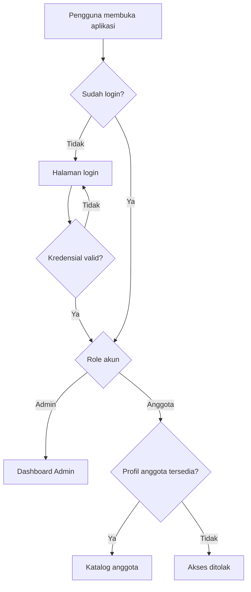
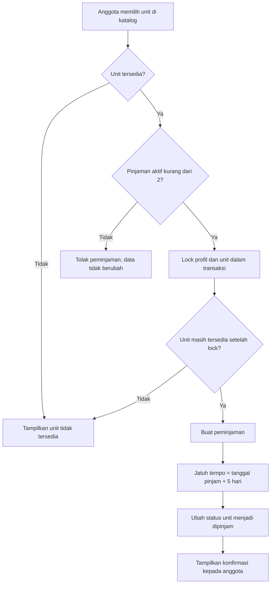
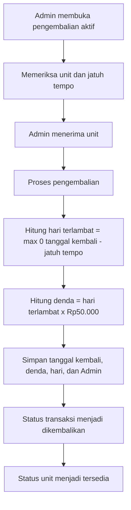

# Flowchart dan ERD Santika

Dokumen ini menggambarkan alur yang tersedia pada aplikasi dan skema yang didefinisikan oleh Laravel migrations.

## 1. Alur masuk dan pengarahan role



## 2. Alur peminjaman anggota



## 3. Alur pengembalian Admin



Tarif Rp50.000 adalah default konfigurasi `DENDA_PER_HARI`; environment dapat mengubah nilainya. Tanggal jatuh tempo tidak terlambat, sehingga denda nol pada tanggal jatuh tempo.

## 4. ERD

```mermaid
erDiagram
    USERS ||--o| PROFILES : "memiliki profil anggota"
    PROFILES ||--o{ PEMINJAMAN : "melakukan"
    UNITS ||--o{ PEMINJAMAN : "dipinjam dalam"
    USERS o|--o{ PEMINJAMAN : "memproses pengembalian"
    UNITS ||--o{ CATEGORY_UNIT : "dikelompokkan"
    CATEGORIES ||--o{ CATEGORY_UNIT : "mengelompokkan"

    USERS {
        bigint id PK
        string name
        string email UK
        string password
        enum role "admin, user"
        timestamp email_verified_at nullable
        timestamp created_at
        timestamp updated_at
    }
    PROFILES {
        bigint id PK
        bigint user_id FK, UK
        string nomor_anggota UK
        string no_telepon nullable
        text alamat nullable
        date tanggal_daftar
        timestamp created_at
        timestamp updated_at
    }
    CATEGORIES {
        bigint id PK
        string nama_kategori UK
        text deskripsi nullable
        timestamp created_at
        timestamp updated_at
    }
    UNITS {
        bigint id PK
        string kode_unit UK
        string nama_unit
        text deskripsi nullable
        enum status "tersedia, dipinjam"
        integer tarif_per_hari
        timestamp created_at
        timestamp updated_at
    }
    CATEGORY_UNIT {
        bigint unit_id PK, FK
        bigint category_id PK, FK
    }
    PEMINJAMAN {
        bigint id PK
        bigint profile_id FK
        bigint unit_id FK
        bigint diproses_oleh FK nullable
        date tanggal_pinjam
        date tanggal_jatuh_tempo
        date tanggal_kembali nullable
        enum status "dipinjam, dikembalikan"
        smallint hari_terlambat
        integer denda
        timestamp created_at
        timestamp updated_at
    }
```

### Catatan kardinalitas dan batasan

- `profiles.user_id` unik: satu akun paling banyak memiliki satu profil. Profil dibuat untuk anggota; akun Admin tidak memiliki profil anggota berdasarkan keputusan lingkup proyek.
- `units.kode_unit`, `categories.nama_kategori`, `users.email`, `profiles.nomor_anggota`, dan `profiles.user_id` memiliki unique constraint.
- Pivot `category_unit` menggunakan primary key gabungan (`unit_id`, `category_id`) untuk mencegah pasangan kategori/unit duplikat.
- Peminjaman terhubung ke profil anggota dan unit. `diproses_oleh` nullable karena belum ada Admin yang memproses pinjaman aktif.
- Penghapusan unit/profil yang direferensikan riwayat peminjaman dibatasi foreign key `RESTRICT`.
- Tabel belum menyimpan status pembayaran denda; status pembayaran berada di luar lingkup saat ini.
